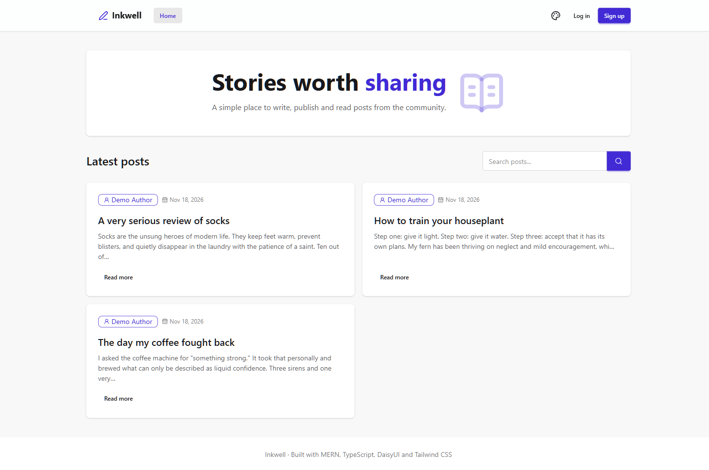
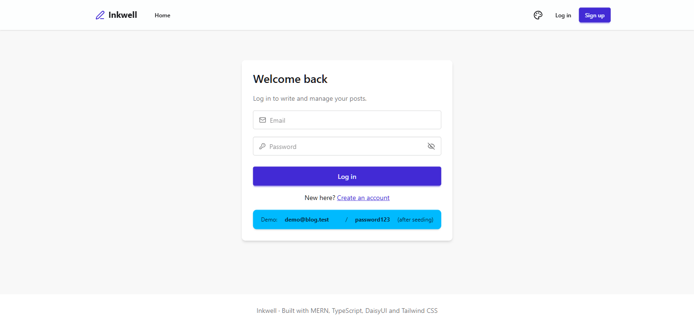
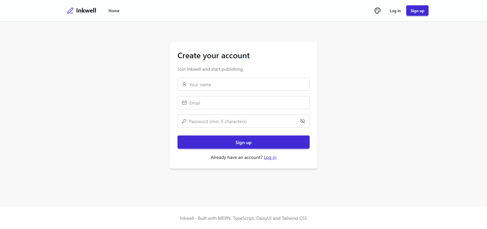
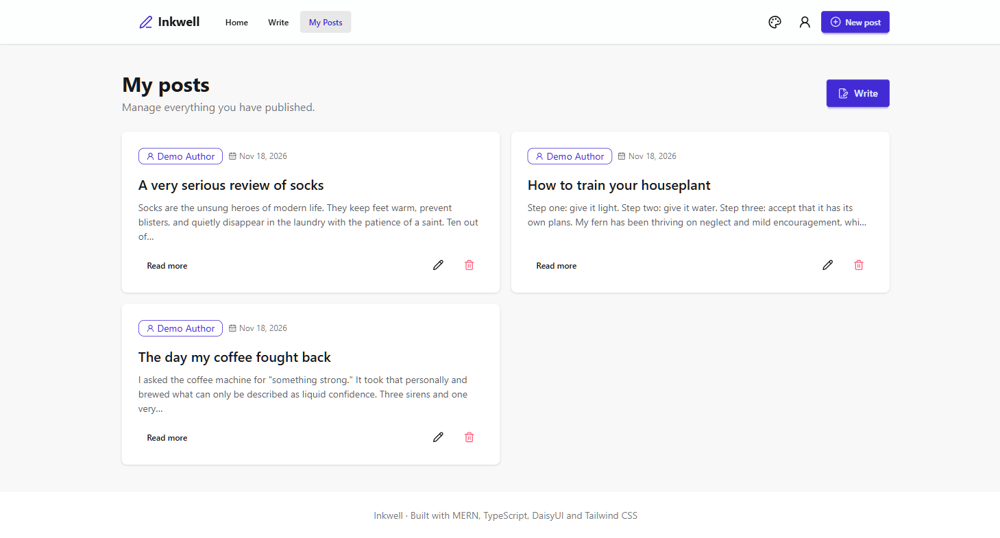
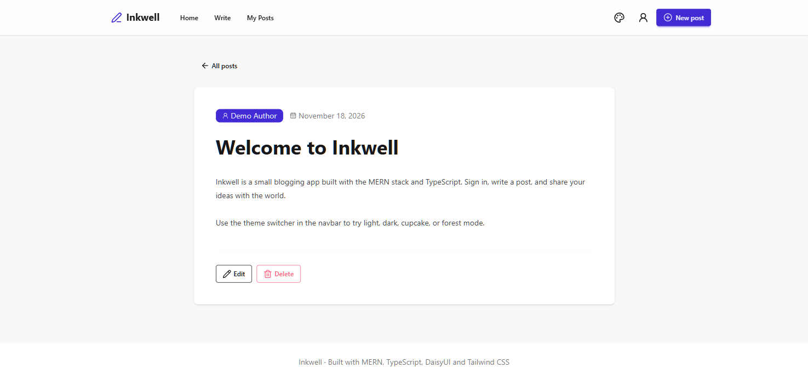
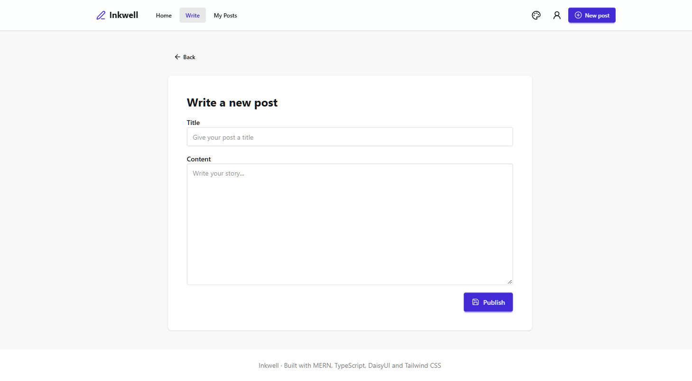
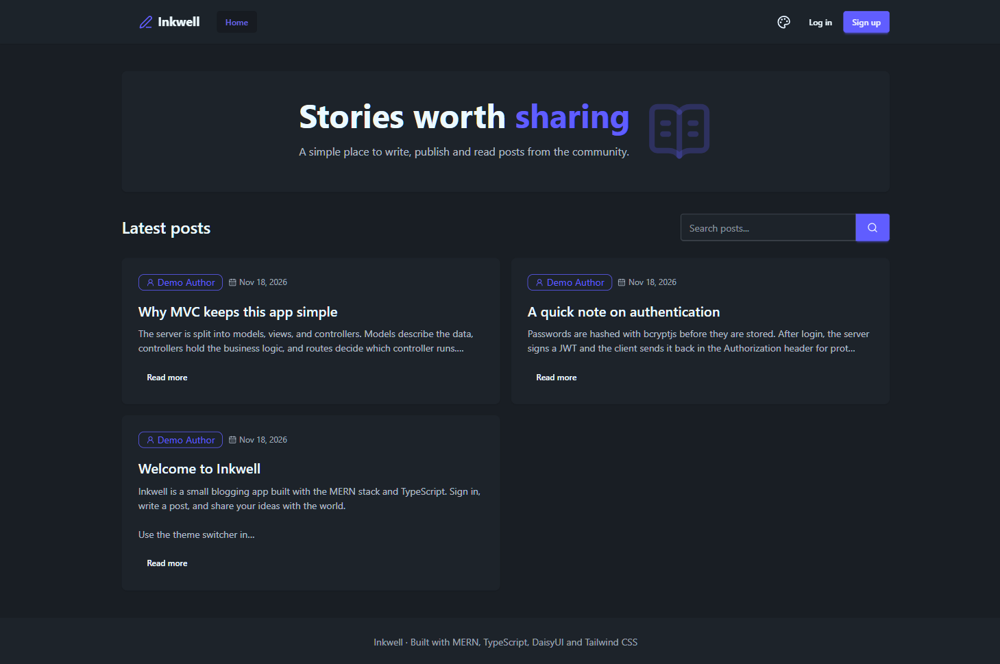
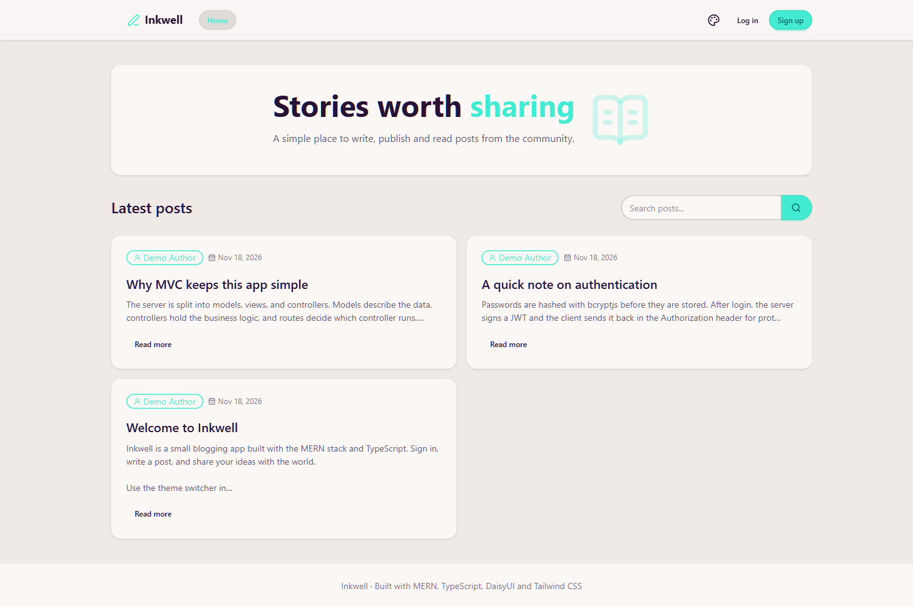
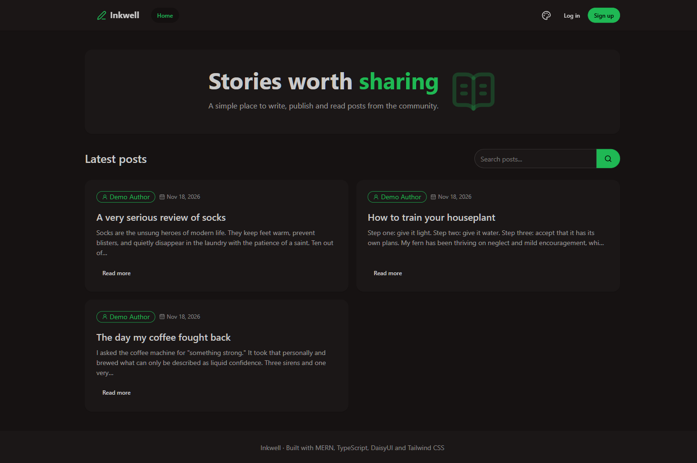

<div align="center">

# Inkwell — MERN Blog with TypeScript

A simple, clean blogging app with JWT authentication, four DaisyUI themes, and an MVC-style Node backend.


</div>

## Features

- Email/password registration and login with bcryptjs hashing
- JWT stored in an **httpOnly cookie** set and cleared by the backend
- Global auth state with Zustand;
- Create, read, update, and delete blog posts
- Only post authors can edit or delete their posts
- Search posts by title
- Four DaisyUI themes: **light**, **dark**, **cupcake**, and **forest**
- Responsive UI built with Tailwind CSS, DaisyUI components, and lucide-react icons
- MVC-style Express server with TypeScript and Mongoose models
- Oxlint and Prettier configured

## Screenshots

Captured from the running app.

|                    Home feed                     |                  Login                  |                   Sign up                    |
| :----------------------------------------------: | :-------------------------------------: | :------------------------------------------: |
|  |  |  |

|                   My posts                    |                     Post detail                     |
| :-------------------------------------------: | :-------------------------------------------------: |
|  |  |

|                      New post form                      |
| :-----------------------------------------------------: |
|  |

### Themes

|                       Light                        |                       Dark                        |
| :------------------------------------------------: | :-----------------------------------------------: |
|  |  |

|                         Cupcake                         |                        Forest                         |
| :-----------------------------------------------------: | :---------------------------------------------------: |
|  |  |

## Tech stack

| Layer    | Technologies                                                                                        |
| :------- | :-------------------------------------------------------------------------------------------------- |
| Client   | React 19, TypeScript, Vite, React Router, Axios, Zustand, Tailwind CSS v4, DaisyUI v5, lucide-react |
| Server   | Node.js, Express, TypeScript, Mongoose, jsonwebtoken, bcryptjs, cookie-parser, CORS                 |
| Database | MongoDB                                                                                             |
| Tooling  | Oxlint, Prettier, concurrently, tsx                                                                 |

## Project structure

```text
.
├── server/
│   └── src/
│       ├── config/        # database and cookie configuration
│       ├── controllers/   # auth and post request logic
│       ├── middleware/    # JWT cookie authentication guard
│       ├── models/        # User and Post Mongoose schemas
│       ├── routes/        # API routes
│       ├── app.ts
│       └── server.ts
├── client/
│   └── src/
│       ├── components/    # Layout, ThemeSwitcher, PostCard
│       ├── lib/           # Axios instance with credentials
│       ├── pages/         # Home, auth, post detail, post form, my posts
│       ├── store/         # Zustand auth store
│       ├── types.ts
│       └── App.tsx
└── docs/screenshots/      # README screenshots
```

## Getting started

Requirements: Node.js 20.19+ and a local MongoDB instance.

```bash
# install everything (root, server, client)
npm run install:all

# start both apps
npm run dev
```

- Client: <http://localhost:5173>
- API: <http://localhost:5000/api>
- Health check: <http://localhost:5000/api/health>

### Environment variables

Copy the example files and edit if needed. The defaults work with local MongoDB at `mongodb://127.0.0.1:27017/inkwell_db`.

`server/env.example`

```env
PORT=5000
MONGO_URI=mongodb://127.0.0.1:27017/inkwell_db
JWT_SECRET=replace-this-with-a-long-random-secret
CLIENT_URL=http://localhost:5173
COOKIE_SAME_SITE=lax
COOKIE_SECURE=false
```

`client/env.example`

```env
VITE_API_URL=http://localhost:5000/api
```

For cross-site production deploys, use `COOKIE_SAME_SITE=none` and `COOKIE_SECURE=true` over HTTPS.

### Demo account

Seed the database with a demo author and three posts:

```bash
npm run seed
```

Then log in with:

```text
demo@blog.test / password123
```

## API

| Method | Endpoint                | Auth | Description                                  |
| :----- | :---------------------- | :--: | :------------------------------------------- |
| POST   | `/api/auth/register`    |  No  | Register and receive an httpOnly auth cookie |
| POST   | `/api/auth/login`       |  No  | Log in and receive an httpOnly auth cookie   |
| POST   | `/api/auth/logout`      |  No  | Clear the auth cookie                        |
| GET    | `/api/auth/me`          |  No  | Current user from the cookie, or `null`      |
| GET    | `/api/posts?q=&author=` |  No  | List, search, or filter posts                |
| GET    | `/api/posts/:id`        |  No  | Get one post                                 |
| POST   | `/api/posts`            | Yes  | Create a post                                |
| PUT    | `/api/posts/:id`        | Yes  | Edit your own post                           |
| DELETE | `/api/posts/:id`        | Yes  | Delete your own post                         |

The `protect` middleware reads `inkwell_token` from the request cookie. On register/login the server sets it with `HttpOnly`, `SameSite=Lax`, a 7-day expiry, and `Secure` in production. Axios sends `withCredentials: true`. Zustand keeps only the user in memory and restores it on reload through `/api/auth/me`.

## Scripts

Run from the repository root:

```bash
npm run dev            # start server and client together
npm run install:all    # install all three package sets
npm run seed           # seed demo data
npm run lint           # Oxlint across server/src and client/src
npm run format         # format all files with Prettier
npm run format:check   # verify formatting
npm run build          # production builds for server and client

```
